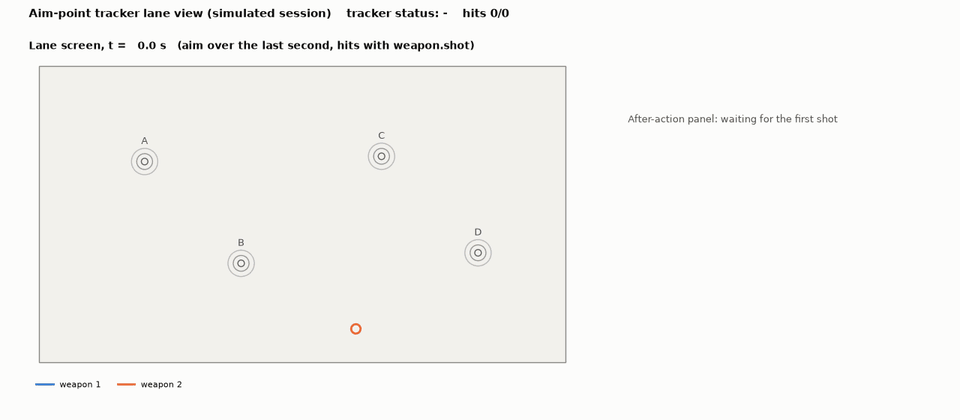
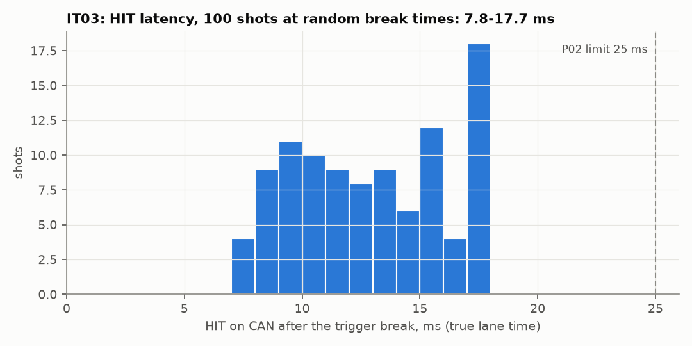
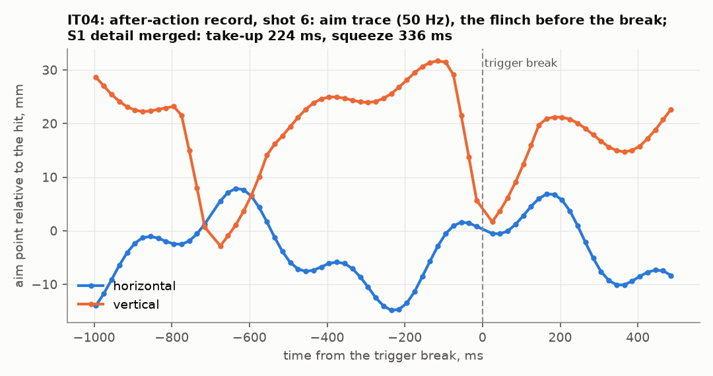
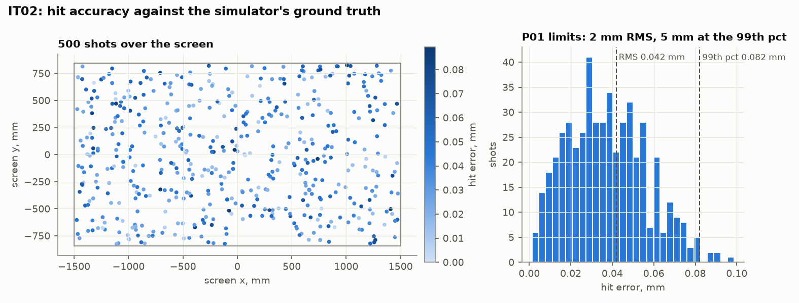

# Camera aim-point tracker

[](https://github.com/chad416/aim-point-tracker/actions/workflows/ci.yml)

Camera-based hit and aim tracking for a small-arms training lane, in C with a simulated IR camera. Each trainer weapon flashes an infrared LED at the muzzle. A camera watching the projection screen finds the spot in every frame and maps it to the screen. It then reports which weapon hit where, plus an aim trace for each weapon between shots.



*A simulated session, drawn only from the tracker's own CAN output: two shooters, two targets each, three shots per target. Weapon 2's emitter is 2 mrad off its bore and was zeroed first. On the right, the after-action record of the latest shot: its aim trace around the break, merged with the weapon's own trigger data. ([video](docs/img/lane_view.mp4))*

It is the third part of a lane in software:
- the trainee's weapon firmware: [trainer-weapon-firmware-twin](https://github.com/chad416/trainer-weapon-firmware-twin) (its v0.6 times the emitter's flashes to this camera, and IT10 runs it here end to end)
- a motion platform: [motion-platform-controller](https://github.com/chad416/motion-platform-controller)
- this tracker

**Contents:**
- [SPEC.md](SPEC.md): specification, requirements and week-by-week results
- [docs/traceability.md](docs/traceability.md): every requirement, its tests and the measured result
- [protocol/tracker.dbc](protocol/tracker.dbc): the CAN frames (HIT, AIM, TRK_STATUS), extending the weapon's DBC

## Status: done (4 weeks)

**How it works:**
1. **Strobed on lane time.** The camera takes 100 frames a second, 1 ms each, on the lane's clock. Each weapon flashes its LED in the middle of the frames of its own time slot. When the trigger breaks, the weapon puts its shot flash into the first frame at least 2 ms later. A random flash would hit a 1 ms exposure only 15 % of the time.
2. **Each frame:** find the spots, locate them to about 0.02 pixel, and map them to millimetres on the screen through the lens calibration.
3. **Each shot:** the weapon's SHOT_EVENT on CAN says when the trigger broke. That fixes the frame, and the spot nearest the shooter's tracked aim is the hit. Two weapons firing into the same frame are told apart by their aim tracks; when they can't be, the HIT says AMBIGUOUS rather than guessing.
4. **Out on CAN:** a HIT for every shot (with a reason if there is no position), the aim of every weapon in its slot frames, and a status every second. Each shot also gets an after-action record: its aim trace from 1 s before to 0.5 s after the break, merged with the weapon's trigger data.

**Built:**
- **C library** (`aimtrk/`, no I/O, no heap): spot detection and sub-pixel centroid; lens and screen geometry and the calibration from a projected dot grid; zeroing; lane time from SYNC; aim tracks and shot matching; the CAN frames.
- **Tracker service** (`host/aim_host`, Linux): frames from a pipe; CAN from SocketCAN or, for repeatable runs, a log; HIT, AIM and TRK_STATUS out, after-action records, zeroing.
- **Camera simulator** (`sim/`): lens, sensor, spots and the calibration grid; lane scenarios with weapons and their CAN traffic; a fast renderer that only draws around each spot; an interference set (projector leak, a sunlit window, glints, hot pixels, a person walking through).
- **Co-simulation with the weapon firmware** (`tools/cosim/`): the firmware runs on two weapons in Renode; every emitter edge and CAN frame it produces is recorded and turned into camera frames for the tracker.
- **Lane view and demo** (`tools/lane/`): a scripted session and the instructor's view drawn from the tracker's output.
- **Tests:**
  - **Unit tests:** 58 of 58 (ztest on `native_sim`), 97.9 % line coverage.
  - **Cross-checks:** against NumPy/SciPy (detection) and OpenCV (geometry, calibration).
  - **Integration tests:** IT01–IT10 pass. IT09 is 100,000 frames; IT10 runs the weapon firmware.

## Results

| Check | Result | Limit |
|---|---|---|
| Hit accuracy over the screen (IT02, P01) | **0.042 mm RMS**, 0.082 mm at the 99th percentile, 500 of 500 shots | 2 mm RMS, 5 mm at the 99th pct |
| HIT latency after the break (IT03, P02) | 7.8–17.7 ms | 25 ms |
| Frame time from SYNC (IT03, IT09, P07) | within 36 µs, and 44 µs over 1000 s | ±100 µs |
| Two weapons, which one hit (IT05, P04) | 160 of 160; 60 of 60 at nearly the same point reported AMBIGUOUS, never a wrong one | 100 %, ≥ 99 % in one frame |
| Interference (IT06, P03) | 57 of 57 visible shots at 4, 8, 12 and 30 DN of projector leak, no false HIT | ≥ 99.9 % |
| **Long run, 100,000 frames (IT09, P03)** | **1953 of 1954 visible shots (99.95 %), 0 false HITs**, 0.16 mm RMS | ≥ 99.9 %, ≤ 1 false HIT |
| Processing per 1280 × 800 frame (IT09, P05) | 1.0 ms median, **2.4 ms at the 99.9th percentile**; no heap growth | 3 ms |
| **With the weapon firmware in Renode (IT10)** | 8 of 8 shots OK within 0.19 mm, 9.5–10.5 ms; 148 aim frames per weapon | P02 |
| No-hit reasons (IT07, F10) | off-screen, out of view, covered, dropped frame: each reported as such | — |
| Calibration residual (IT01, P06) | 0.023 px fitted, 0.023 px held-out | 0.3 px, 0.5 px |
| Zeroing (IT08) | 11.5 mm RMS before, 0.64 mm after five shots | P01 after zeroing |
| CAN bus load, two weapons at 900 rpm (IT05) | 311 frames/s, 7.6 % of 500 kbit/s | under 10 % |

The simulation meets P01 by a factor of 50. That is not a claim about a real lane. The simulated lens follows the same distortion model the calibration fits, and the simulated screen is flat, with the projected dots exactly where they should be. A real lens, a fabric screen and a projector move points by millimetres, and the 2 mm limit is there for them (SPEC §3.3).



*IT03: 100 shots at random break times; HIT on CAN 7.8–17.7 ms after the trigger break, in true lane time.*



*IT04: one after-action record. The aim trace around the break (50 Hz, two slots), with the shooter's flinch just before it, and the weapon's own trigger data merged in.*



*IT02: 500 shots spread over the screen, after calibration, measured against the simulator's ground truth.*

## What testing found

- **The weapon firmware's flashes were up to a fifth too long.** IT10 runs the real firmware in Renode and records its emitter edges. In v0.6.0 the pulses lasted 563–610 µs instead of 500 µs, so 8 of 306 ran up to 80 µs past the end of the exposure (every shot was still found). The firmware's timer added a tick to each pulse; v0.6.1 fixed it, and IT10 now sees 480–526 µs pulses, all inside their exposure (SPEC §12).
- **A stray could take over a weapon's track.** The first 100,000-frame run missed 24 % of the shots and made 13 false hits. When a weapon's spot disappeared, its track jumped to a stray that came back every 48 frames. A track now starts only on a strong spot that is seen again in the weapon's next slot frame, and lets go of a wrong spot after three slot frames (SPEC §6.6).
- **A scene change one threshold high was the hard case, not the brightest one.** The demo, at 8 DN of projector leak, lost 4 of 12 shots among 6499 stray spots: noise broke the moving silhouette's edge into hundreds of spot-sized pieces. They also filled the detector's blob table, which dropped the real spots after them. The fix also recovered the 7 of 57 shots that had been lost at 30 DN. A spot must now stand out from its own surroundings, and blobs too small to be a spot never take a table place (SPEC §6.1).
- **The shot flash needs 2 ms, not 0.5 ms.** The weapon firmware only sees a break up to 1 ms late and fires within 1.5 ms, so with 0.5 ms it would have missed its own frame (SPEC §6.5).
- **A person walking past broke the background.** The background held their dark shape and produced thousands of false spots. It now snaps to big changes, and the threshold uses the brightest neighbouring cell: from 4083 to 33 false spots in the same run (SPEC §6.1).
- **Every weapon needs dark frames.** The background is frozen under a spot, so a weapon flashing in every frame would leave its aim point's background stale. Even a single weapon gets a dark frame between flashes (SPEC §6.5).
- **A single plane does not pin down k2.** The fitted k2 ranged from 0.0003 to 0.0195 around the true 0.01 while the mapping stayed within 0.073 mm. The tracker uses the mapping, never k2 alone (SPEC §6.4).

## Quick start (Windows 11 + WSL2 Ubuntu 24.04)

The Zephyr workspace and Python environment are shared with the other two projects. The CI workflow (`.github/workflows/ci.yml`) lists the exact setup.

```bash
bash scripts/test-unit.sh                # ztest unit tests on native_sim (twister)
bash scripts/crosscheck.sh               # C vs NumPy and OpenCV, then the centroid curves
bash scripts/test-it.sh                  # integration tests IT01-IT08 and IT10 (replay), and their plots
python3 -m pytest tests/integration -m long    # IT09: 100,000 frames, about 5 minutes
python3 -m pytest tests/integration -m cosim   # IT10 again with the weapon firmware in Renode
python3 tools/lane/demo_session.py       # the demo session -> docs/session/
python3 tools/lane/lane_view.py docs/session --png view.png   # the lane view (--frames DIR for a GIF)
```

The Renode re-recording needs Renode 1.17 and the weapon firmware's ELF and `sim/` (see `tools/cosim/cosim.py`).

## Honest limits

- **The camera is simulated.** Accuracy is measured against the simulator's own ground truth. The sensor and lens values are assumptions for a sensor of this class, not datasheet values. The lens model is the one the calibration fits.
- **The screen is flat**, and the projected calibration dots are where the grid says.
- **In IT10 only the weapon is real firmware.** It decides when each flash happens and what goes on CAN. Where the weapon aims is scripted, and the camera is still the simulator.
- **The fast renderer repeats its background noise every 48 frames.** Only the spots get fresh noise in every frame.
- **The projector leak levels are assumptions** (4, 8, 12, 30 DN), not measured data.
- **Timing is from the development PC (x86, WSL2) and CI runners, not a target board.** Both are virtual machines: the slowest frames in IT09 (up to 13 ms) are ordinary frames the host interrupted, so P05 is checked at the 99.9th percentile. With other work running on the PC, one run reached 3.4 ms there.
- **The SocketCAN path of `aim_host` builds but no test runs it.** IT10 replays the firmware's CAN traffic through the log transport, so that it runs in CI.

## Layout

```
aimtrk/            C library: detect, centroid, geom, calib, zero, timesync, track, match, proto, linalg
host/              aim_host, the tracker service (Linux)
protocol/          tracker.dbc, test vectors and their generator
sim/               camera simulator and lane scenarios
tests/unit/        ztest suites
tests/integration/ IT01-IT10 (pytest)
tests/data/        the weapon firmware's Renode run, replayed by IT10
tools/cosim/       Renode driver and replay for IT10
tools/lane/        demo session, lane view, scenario runner
tools/reference/   NumPy reference, ctypes bindings, cross-checks, accuracy curves, plots
tools/calib/       calibration runner (calib.json with version and CRCs)
docs/              traceability, the demo session, lane view images
results/           measured results and plots
scripts/           test helpers
```
