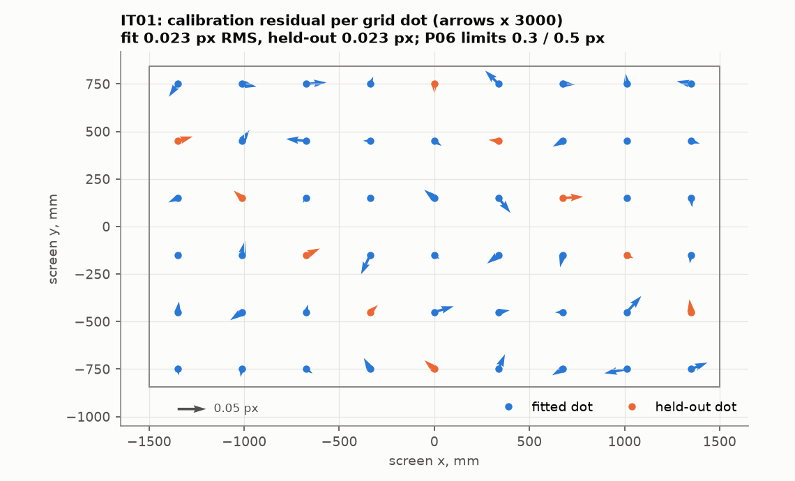

# Camera aim-point tracker

[](https://github.com/chad416/aim-point-tracker/actions/workflows/ci.yml)

Camera-based hit and aim tracking for a small-arms training lane, in C with a simulated IR camera. Each trainer weapon flashes an infrared LED at the muzzle. A camera watching the projection screen finds the spot in every frame and maps it to the screen. It then reports which weapon hit where, plus an aim trace for each weapon between shots.

It is the third part of a lane in software:
- the trainee's weapon firmware: [trainer-weapon-firmware-twin](https://github.com/chad416/trainer-weapon-firmware-twin)
- a motion platform: [motion-platform-controller](https://github.com/chad416/motion-platform-controller)
- this tracker

**Contents:**
- [SPEC.md](SPEC.md): specification, requirements and week-by-week results

## Status: week 2 of 4

**Done:**
- **Camera simulator** (`sim/camsim.py`):
  - a pinhole camera with lens distortion looking at the screen;
  - emitter spots, including the pulse's overlap with the exposure and the smear from aim motion;
  - a sensor model (shot, read and fixed-pattern noise, hot pixels, 8-bit output, saturation);
  - the projected calibration grid, and an emitter misaligned from the bore;
  - ground truth for every spot.
- **C library** (`aimtrk/`, no I/O, no heap):
  - **Spot detection:** a background on a 4 × 4 cell grid, frozen under spots; a noise estimate from the median absolute deviation; runs and union-find blobs; rejection rules. One fixed memory block of 475 kB for a 1280 × 800 frame.
  - **Sub-pixel centroid**, plus a Gaussian rim fit for saturated spots.
  - **Lens and screen geometry:** Brown–Conrady distortion with a Newton inverse; a normalised DLT homography; pixel ↔ screen mm, with off-screen points reported, not dropped.
  - **Calibration** from a projected 9 × 6 dot grid:
    - The dots are ordered from the grid's corners.
    - Levenberg–Marquardt fits the homography and the distortion.
    - Every fifth dot is held out to check the fit, and a bad fit is refused.
  - **Zeroing** per weapon: the offset from five shots, refused if the group is scattered.
- **Tests:**
  - **Unit tests:** 35 of 35 pass (ztest on `native_sim`), 97.8 % line coverage.
  - **Detection cross-check** against an independent NumPy/SciPy version: 40 simulated frames, 312 spots, 0 mismatches.
  - **Geometry and calibration cross-check** against OpenCV (`projectPoints`, `undistortPoints`, `findHomography`, `calibrateCamera`).
  - **Integration tests** on rendered frames (pytest): IT01 calibration, IT02 accuracy over the screen, IT08 zeroing.

**Not yet** (weeks 3–4): time slots and shot matching, the CAN frames, the tracker service, the faster renderer, interference, the end-to-end run with the weapon firmware, and the lane view.

## Results


*IT02: 500 shots spread over the screen, after calibration, measured against the simulator's ground truth (real output of `tests/integration`).*

| Check | Result | Limit |
|---|---|---|
| Hit accuracy over the screen (IT02, P01) | **0.039 mm RMS**, 0.082 mm at the 99th percentile, 500 of 500 shots found | 2 mm RMS, 5 mm at the 99th percentile |
| Calibration residual (IT01, P06) | 0.023 px fitted, 0.023 px held-out | 0.3 px, 0.5 px |
| Zeroing (IT08) | 11.5 mm RMS before, 0.63 mm after five shots | P01 after zeroing |
| Centroid at the nominal spot | 0.018 px RMS (about 0.05 mm) | 0.1 px in the error budget |
| Processing per 1280 × 800 frame, C | 1.2 ms mean, 2.0 ms worst (varies a little run to run) | 3 ms |

The simulation meets P01 by a factor of 50. That is not a claim about a real lane. The simulated lens follows the same distortion model the calibration fits, and the simulated screen is flat, with the projected dots exactly where they should be. A real lens, a fabric screen and a projector move points by millimetres, and the 2 mm limit is there for them (SPEC §3.3).



*IT01: the calibration residual of every grid dot, with the held-out dots in orange. The calibration assumes a focal length 10 px off and a principal point 4.3 px off, and the fit absorbs both.*


*Centroid error against signal for four spot sizes (`tools/reference/centroid_curve.py`, 400 spots per point). Every spot is found from 16 DN up, so the nominal spot (150 DN) has about 9 times the signal it needs.*

**Found so far:**
- **Every weapon needs dark frames.** The background is frozen under a spot, so a weapon flashing in every frame would leave its aim point's background stale. Even a single weapon gets a dark frame between flashes (SPEC §6.5).
- **The simulator is too slow for long runs.** It renders a full frame in 26–48 ms. The 100,000-frame run and the live demo need a renderer that draws only the area around each spot (SPEC §12).
- **A single plane does not pin down k2.** Over 20 noise draws, the fitted k2 ranged from 0.0003 to 0.0195 around the true 0.01, while the mapping stayed within 0.073 mm. The tracker uses the mapping, never k2 alone (SPEC §6.4).
- **The grid should reach the screen edges.** Beyond the outermost dots, the calibration extrapolates and its error grows several times (SPEC §6.4).
- **OpenCV's `findHomography` is the less exact one on exact data.** The C DLT reproduces the true homography to 5e-13 px; OpenCV's refinement stops at 3e-5 px (SPEC §6.3).

## Quick start (Windows 11 + WSL2 Ubuntu 24.04)

The Zephyr workspace and Python environment are shared with the other two projects. The CI workflow (`.github/workflows/ci.yml`) lists the exact setup.

```bash
bash scripts/test-unit.sh        # ztest unit tests on native_sim (twister)
bash scripts/crosscheck.sh       # C vs NumPy and OpenCV, then the centroid curves
bash scripts/test-it.sh          # integration tests IT01, IT02, IT08 and their plots
python3 tools/calib/calibrate.py # calibrate the simulated lane -> results/calib.json
python3 sim/camsim.py lane       # reference lane check
python3 sim/camsim.py bench      # simulator speed and pipe throughput
```

## Honest limits

- **The camera is simulated.** Accuracy is measured against the simulator's own ground truth. The sensor and lens values are assumptions for a sensor of this class, not datasheet values. The lens model is the one the calibration fits.
- **The screen is flat**, and the projected calibration dots are where the grid says.
- **Timing is from the development PC (x86, WSL2), not a target board.**
- **The tracker service (`aim_host`) is not written yet.** Until then, the integration tests drive the C library through Python bindings (ctypes).

## Layout

```
aimtrk/            C library: detect, centroid, geom, calib, zero, linalg (no I/O, no heap)
sim/               camera simulator
tests/unit/        ztest suites
tests/integration/ IT01, IT02, IT08 on rendered frames (pytest)
tools/reference/   NumPy reference, ctypes bindings, cross-checks, accuracy curves, plots
tools/calib/       calibration runner (calib.json with version and CRC)
results/           measured results and plots
scripts/           test helpers
```
