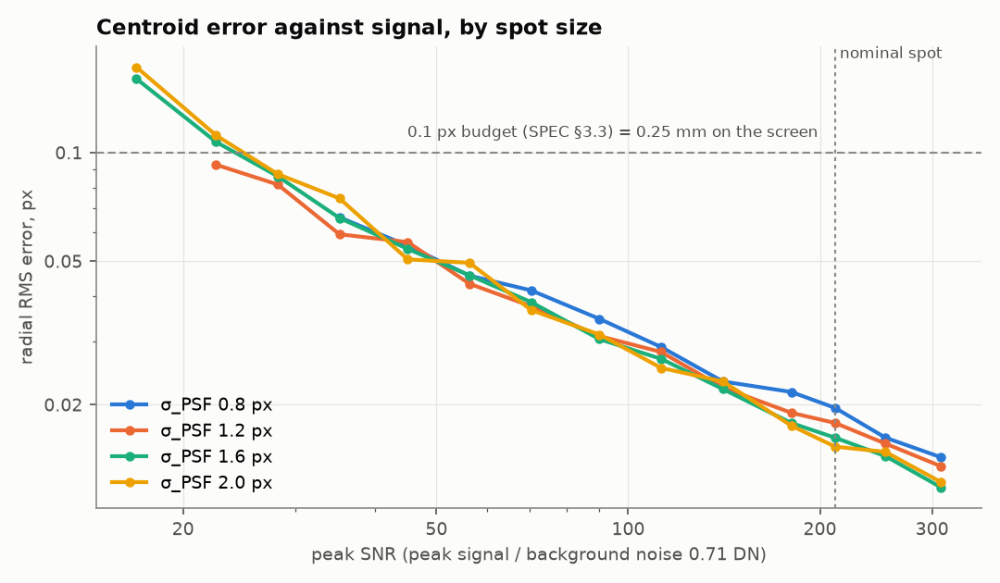
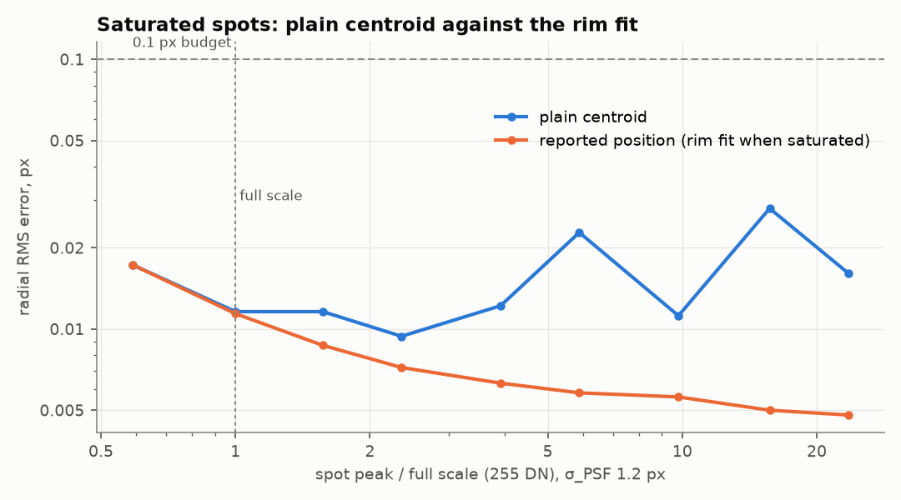

# Camera aim-point tracker

[](https://github.com/chad416/aim-point-tracker/actions/workflows/ci.yml)

Camera-based hit and aim tracking for a small-arms training lane, in C with a simulated IR camera. Each trainer weapon flashes an infrared LED at the muzzle. A camera watching the projection screen finds the spot in every frame and maps it to the screen. It then reports which weapon hit where, plus an aim trace for each weapon between shots.

It is the third part of a lane in software:
- the trainee's weapon firmware: [trainer-weapon-firmware-twin](https://github.com/chad416/trainer-weapon-firmware-twin)
- a motion platform: [motion-platform-controller](https://github.com/chad416/motion-platform-controller)
- this tracker

**Contents:**
- [SPEC.md](SPEC.md): specification, requirements and week-by-week results

## Status: week 1 of 4

**Done:**
- **Camera simulator** (`sim/camsim.py`):
  - a pinhole camera with lens distortion looking at the screen;
  - emitter spots, including the pulse's overlap with the exposure and the smear from aim motion;
  - a sensor model (shot, read and fixed-pattern noise, hot pixels, 8-bit output, saturation);
  - ground truth for every spot.
- **Spot detection and sub-pixel centroid in C** (`aimtrk/`):
  - a background on a 4 × 4 cell grid, frozen under spots;
  - a noise estimate from the median absolute deviation;
  - runs and union-find blobs, rejection rules;
  - a weighted centroid, plus a Gaussian rim fit for saturated spots.
  - No heap: one fixed memory block of 475 kB for a 1280 × 800 frame.
- **Tests:**
  - 21 of 21 unit tests (ztest on `native_sim`), 99.7 % line coverage;
  - a frame-by-frame cross-check against an independent NumPy/SciPy version: 40 simulated frames, 312 spots, 0 mismatches.

**Not yet** (weeks 2–4): lens calibration and screen mapping, time slots and shot matching, the CAN frames, the tracker service, the end-to-end run with the weapon firmware, and the lane view.

## Week 1 results



*Centroid error against signal for four spot sizes (real output of `tools/reference/centroid_curve.py`, 400 spots per point).*

At the nominal spot (peak 150 DN, σ 1.2 px), the error is **0.018 px RMS, or about 0.05 mm on the screen**. The error budget allows 0.1 px. Every spot is found from 16 DN up, so the nominal spot has about 9 times the signal it needs.



*Saturated spots up to 24 times full scale: the rim fit stays within 0.009 px.*

| Check | Result | Source |
|---|---|---|
| Screen inside the camera frame | 35 px margin; 2.4–2.9 mm per pixel (keystone) | `results/lane_check.json` |
| Processing per 1280 × 800 frame, C | 1.1 ms mean, 1.9 ms worst (limit 3 ms) | `results/crosscheck.json` |
| Simulator render time per frame | 48 ms (Poisson noise), 26 ms (Gaussian approximation) | `results/camsim_bench.json` |
| Frame pipe throughput | 1270 MB/s; 100 fps needs 100 MB/s | `results/camsim_bench.json` |

**Found in week 1:**
- **Every weapon needs dark frames.** The background is frozen under a spot, so a weapon flashing in every frame would leave its aim point's background stale. Even a single weapon gets a dark frame between flashes (SPEC §6.5).
- **The simulator is too slow for long runs.** It renders a full frame in 26–48 ms. The 100,000-frame run and the live demo will need a renderer that draws only the area around each spot (SPEC §12).

## Quick start (Windows 11 + WSL2 Ubuntu 24.04)

The Zephyr workspace and Python environment are shared with the other two projects. The CI workflow (`.github/workflows/ci.yml`) lists the exact setup.

```bash
bash scripts/test-unit.sh        # ztest unit tests on native_sim (twister)
bash scripts/crosscheck.sh       # C vs NumPy on simulated frames, then the centroid curves
python3 sim/camsim.py lane       # reference lane check
python3 sim/camsim.py bench      # simulator speed and pipe throughput
```

## Honest limits

- **The camera is simulated.** Accuracy is measured against the simulator's own ground truth. The sensor and lens values are assumptions for a sensor of this class, not datasheet values.
- **Timing is from the development PC (x86, WSL2), not a target board.**

## Layout

```
aimtrk/          C library: detect, centroid (no I/O, no heap)
sim/             camera simulator
tests/unit/      ztest suites
tools/reference/ NumPy reference, ctypes bindings, cross-check, accuracy curves
results/         measured results and plots
scripts/         test helpers
```
